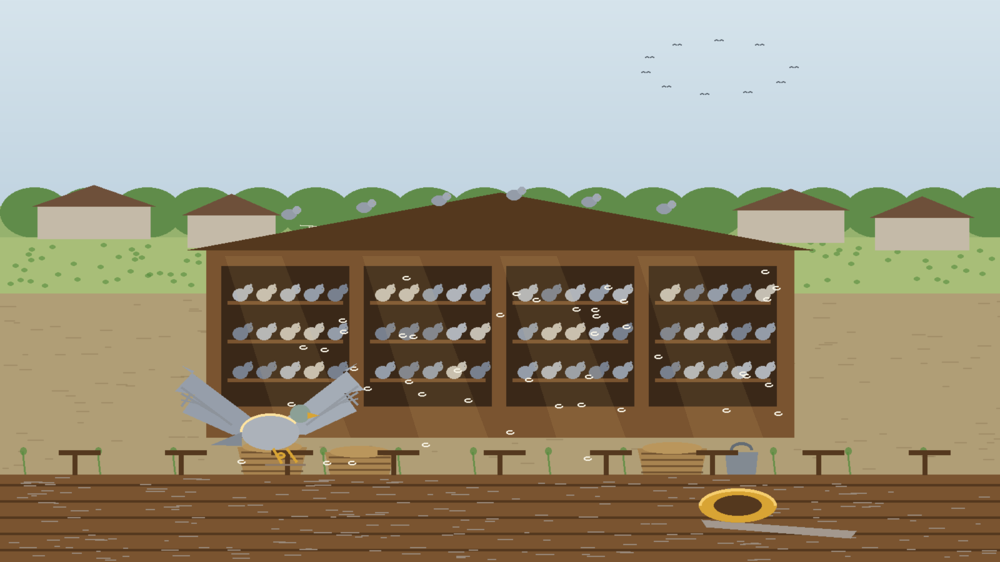
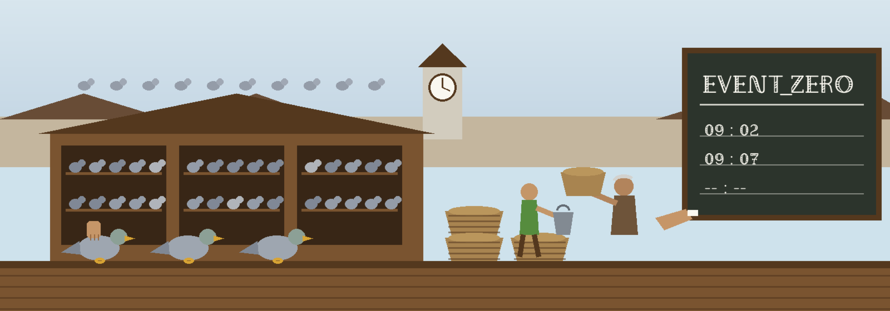
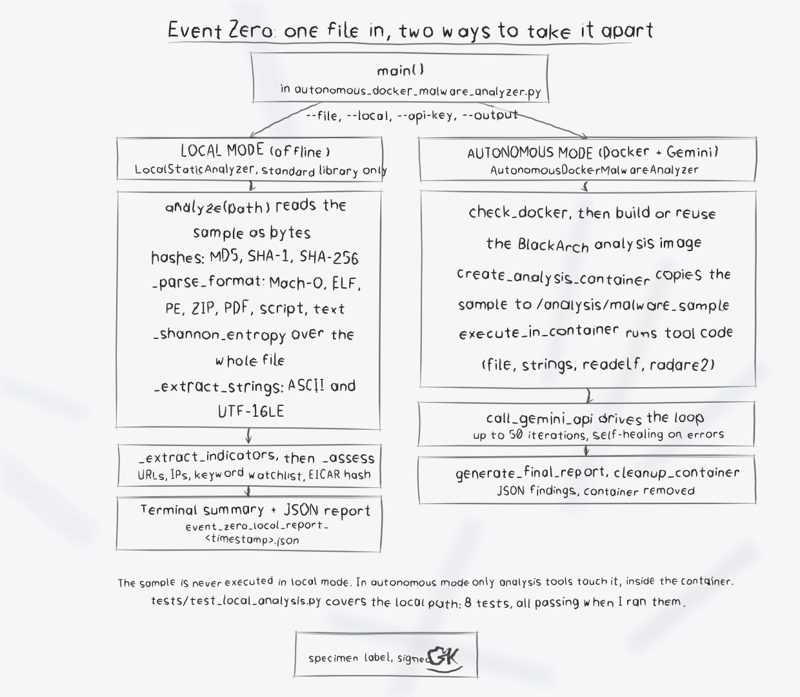

# Event Zero: Malware Analysis, Two Modes




Event Zero analyzes a suspicious file in one of two ways:

1. **Local mode** (works anywhere): offline static analysis written in pure
   Python standard library. No Docker, no network, no API key. The sample is
   read as bytes and never executed.
2. **Autonomous mode** (needs Docker and a Gemini API key): builds a BlackArch
   Linux container, copies the sample in, and lets Gemini direct standard
   analysis tools (file, strings, readelf, radare2 and friends) over several
   iterations, then writes a JSON report.

> WARNING: only analyze files you are authorized to inspect, on a machine you
> are prepared to isolate. Local mode never runs the sample. Autonomous mode
> executes analysis tooling against it inside a container; for genuinely
> hostile samples use a hardened, network-isolated VM (FlareVM, Kali, or
> similar) rather than a workstation.

---

## Quick Start: Local Mode

Requires Python 3.8 or newer. Nothing to install.

```bash
git clone https://github.com/Epsilon0xCell/Event_Zero.git
cd Event_Zero

# Analyze the included test sample (a harmless Mach-O binary with planted strings)
python3 autonomous_docker_malware_analyzer.py --file fake_malware --local
```

Local mode prints a plain-English summary to the terminal and writes a JSON
report next to where you ran it (`event_zero_local_report_<timestamp>.json`,
or pass `--output report.json` to choose the path).

> **Clocking slip.** Tied as a ring is tied, in the secretary's hand: read as bytes, never executed, no network, nothing sent anywhere.

### What local mode actually computes

Everything below is calculated directly from the file bytes. Nothing is
guessed and nothing is sent anywhere:

- **Hashes**: MD5, SHA-1, SHA-256.
- **Format parsing**: real header parsing for Mach-O (including fat binaries,
  segments, sections, and linked libraries), ELF (class, machine, object
  type), and PE (machine, PE32/PE32+, section names). ZIP, PDF, scripts, and
  plain text are identified by signature.
- **Entropy**: whole-file Shannon entropy, with the caveat noted in the report
  when a binary format carries large zero-padded regions.
- **Strings**: printable ASCII and UTF-16LE strings.
- **Indicators**: URLs and IP addresses found in strings, hits against a
  built-in suspicious-keyword watchlist (presented as leads, not proof), and
  detection of the EICAR anti-malware test file by its known SHA-256.
- **Assessment**: a short rule-based summary of those findings. It states its
  limits in the report itself: static analysis only, and absence of
  indicators is not proof a file is safe.

---


## Autonomous Mode

### Prerequisites

- **Docker** installed and the daemon running
- **Python 3.8+**
- **Google Gemini API key** (get one at
  [Google AI Studio](https://aistudio.google.com/app/apikey))

### Run

```bash
export GEMINI_API_KEY="your-gemini-api-key-here"
python3 autonomous_docker_malware_analyzer.py --file /path/to/sample
```

This builds (or reuses) a BlackArch analysis image, starts a container with
the sample at `/analysis/malware_sample`, and iterates: Gemini proposes
analysis code, the code runs in the container, results are collected, and the
loop continues until the model marks the analysis complete or
`--max-iterations` is reached. If the API fails repeatedly, a built-in
fallback performs basic static analysis inside the container instead. A final
`autonomous_analysis_report_<timestamp>.json` is written, and the container
is stopped and removed (the image is kept for reuse).

Notes on how it talks to Gemini: the API key is passed to the container as an
environment variable and read there by a fixed caller script (the current
`google-genai` SDK, model `gemini-2.5-flash`); prompts are transferred as
files, never pasted into generated code.

---

## Command Line Options

```bash
python3 autonomous_docker_malware_analyzer.py --file PATH [OPTIONS]

Required:
  --file, -f PATH          File to analyze

Modes:
  --local                  Offline static analysis only (no Docker, no API key)

Optional:
  --api-key KEY            Gemini API key (or set GEMINI_API_KEY)
  --max-iterations N       Autonomous mode iteration cap (default: 50)
  --output PATH            Report path for local mode
  --verbose / --quiet      Output detail (verbose is the default)
```

Exit codes: `0` on success, `1` on a clean, explained failure (missing file,
missing API key, Docker unavailable), `2` on bad command line arguments.

---


## Tests

```bash
python3 -m unittest discover -s tests -v
```

The test suite covers the local engine (hashes verified against hashlib,
EICAR detection, Mach-O parsing of the bundled sample, indicator extraction)
and CLI smoke tests (help output, local mode end to end, clean failure with
no API key).

---

## The Bundled Sample

`fake_malware` is a real executable, not an inert text fixture: a Mach-O
64-bit ARM64 binary (33,920 bytes) built as the test sample for this
analyzer. It contains planted strings (for example `192.168.1.100`,
`127.0.0.1`, a fake credential line, and a socket symbol) so you can watch
local mode find them, and that is not all it does.

If the binary is executed, its embedded steps run as shell commands in
the shape of arguments to `system()`: `whoami`, `id`, and `uname` output
written to files under `/tmp`, a persistence script created at
`/tmp/persistence.sh` and made executable (written there, not installed
in any autostart location), a process list dumped to `/tmp`, a test file
removed, and a connection attempt to `127.0.0.1` port `4444`, which is
loopback. Its own printed output lists what it simulated, including a
line about a crypto mining simulation: CPU looping, with no mining pool
endpoint in the binary.

What the security audit of this repo (2026-10-30) could verify, and what
it could not: every observed effect is confined to `/tmp` and loopback,
and no external network destination was found in the binary. The audit
was static, and no Mach-O disassembler was available to it, so it could
not confirm call by call which embedded strings reach `system()`. Treat
this file as live sample code and never execute it outside a controlled
analysis environment. Event_Zero itself never executes it in local mode:
local mode reads it as bytes and analyzes it, and autonomous mode runs
analysis tooling on it inside a container.

---

## Troubleshooting

**"GEMINI_API_KEY environment variable required for autonomous mode"**:
either export a key, or add `--local` to run offline static analysis instead.

**"Docker CLI not found" / "daemon is not running"**: start Docker, or use
`--local`. Local mode needs nothing but Python.

**Permission errors talking to Docker (Linux)**: add your user to the docker
group (`sudo usermod -aG docker $USER`), then log out and back in.

---

## Contributing

1. Fork the repository
2. Create a feature branch (`git checkout -b feature/YourFeature`)
3. Commit your changes
4. Push the branch and open a Pull Request

## License

Creative Commons Attribution-NonCommercial 4.0 International. See the
[LICENSE](LICENSE) file.

## Support

- Issues: [GitHub Issues](https://github.com/Epsilon0xCell/Event_Zero/issues)
- Discussions: [GitHub Discussions](https://github.com/Epsilon0xCell/Event_Zero/discussions)

---

## Diagrams and maps

I drew the system out in [Event_Zero-Visuals](Event_Zero-Visuals/): an architecture diagram, a data-flow diagram, a flowchart of a run, and a product map, with the written product map, statistics with citations, and the roadmap in [VISUAL.md](Event_Zero-Visuals/VISUAL.md). Every sheet also ships as a PNG photograph of the paper page beside its SVG.

